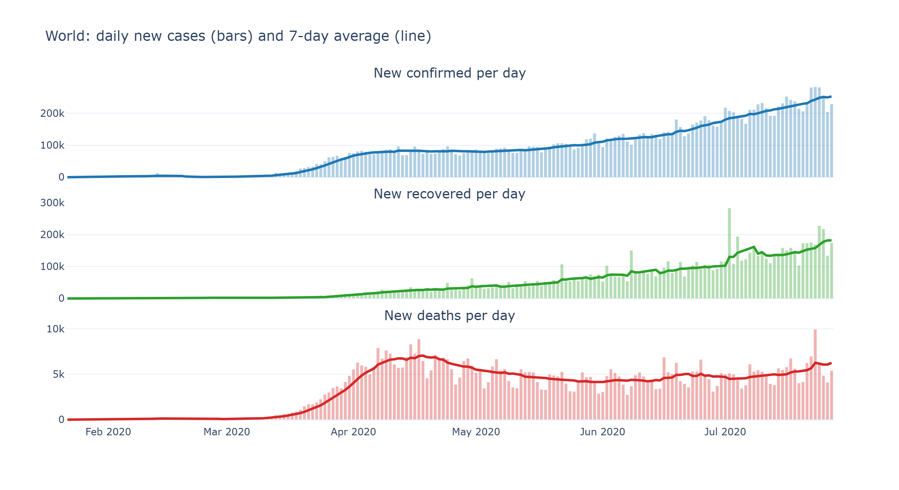
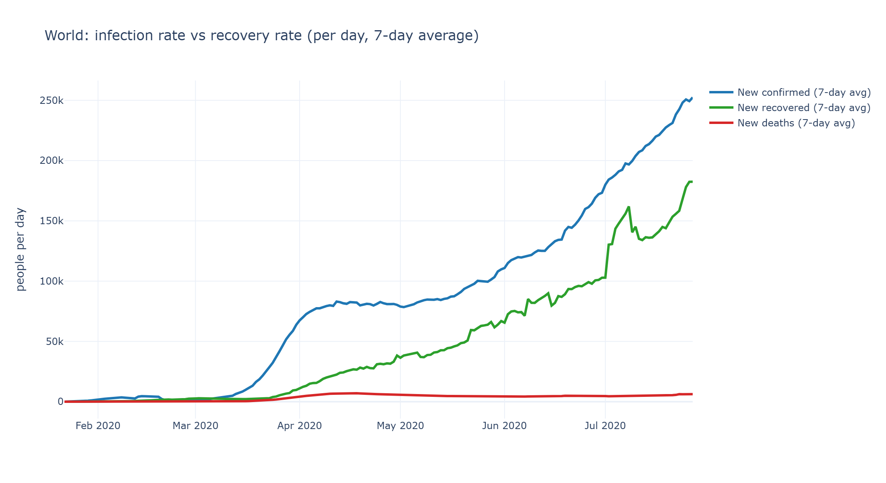
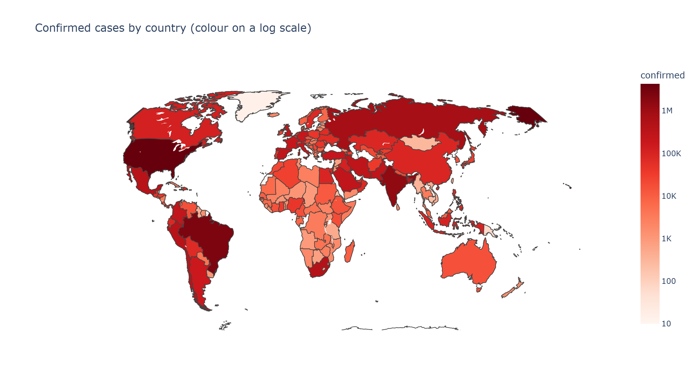
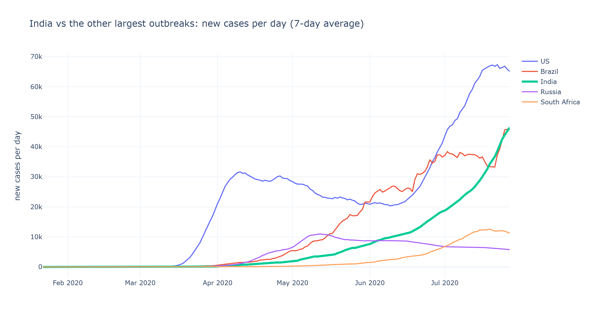
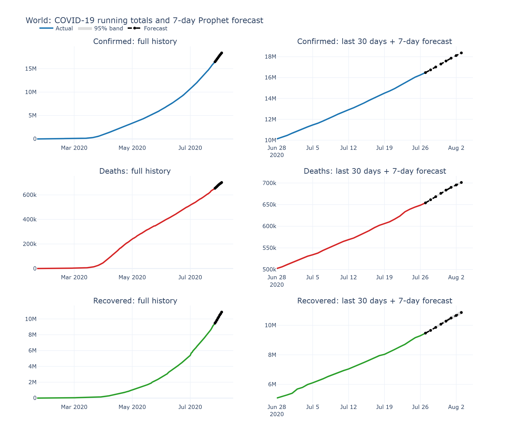
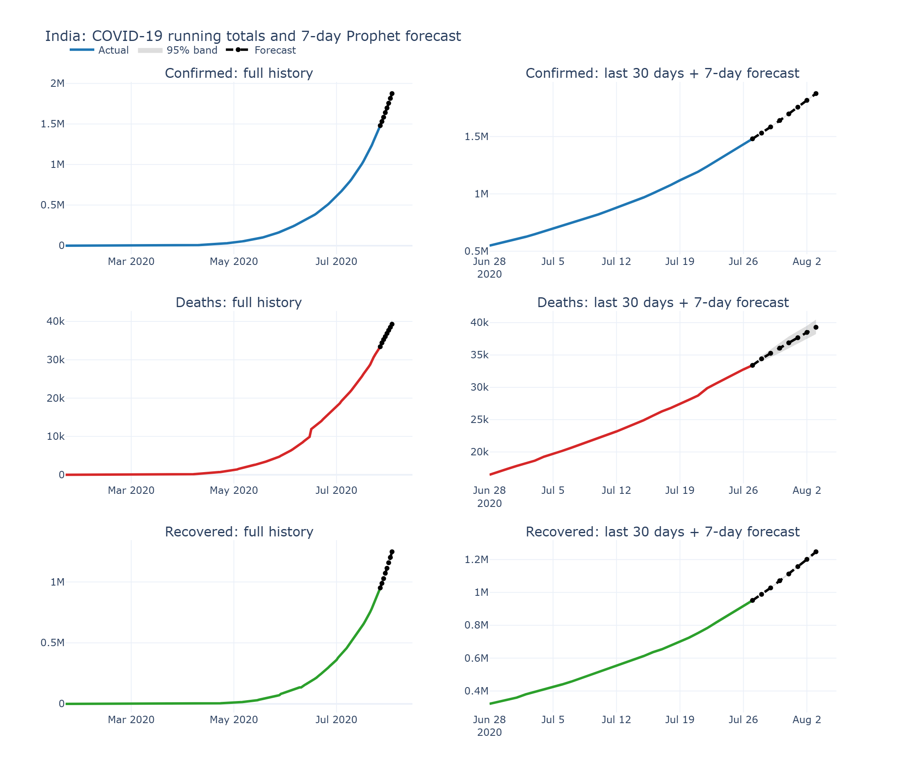
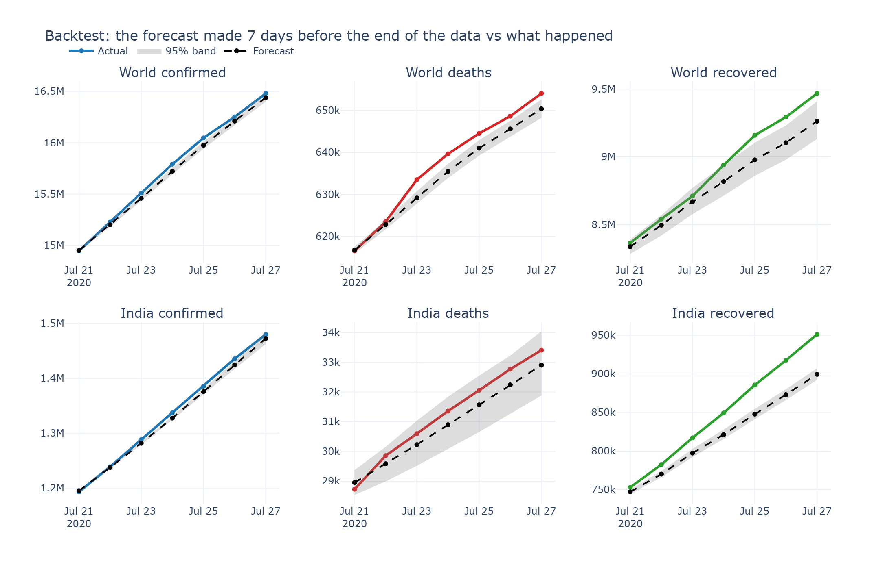

# Analyzing the Trends of COVID-19 with Python

Intellipaat Python for Data Science: Project

Author: Ganesh

## 1. Problem

Given data about COVID-19 patients, visualize the impact, analyze the trend of the rate of infection and
recovery, and predict the number of cases expected a week into the future based on the current trend.

Tools required by the assignment: **pandas** to prepare the data, **Plotly** for interactive visualizations,
and **Facebook Prophet** for time series models, combined to visualize the predictions.

## 2. Data

File: `data/raw/covid_19_clean_complete.csv` (49,068 rows, 10 columns)

| Column | Meaning |
|---|---|
| Province/State | Region inside a country (filled only for countries reported by region) |
| Country/Region | Country name (187 countries) |
| Lat, Long | Location |
| Date | 22 Jan 2020 to 27 Jul 2020 (188 days) |
| Confirmed, Deaths, Recovered, Active | **Running totals** up to that date |
| WHO Region | Six WHO regions |

The assignment mentions several CSV and Excel files (world and India). Only this single file was available. It contains
all countries including India, so both the world and the India analysis are done from it. There is no state-level
data for India, and no population data, so all comparisons use raw counts and not per-million figures.

## 3. Project structure

```
covid19_project/
├── main.py                       # runs steps 1 to 4 in order
├── requirements.txt
├── README.md
├── data/
│   ├── raw/                      # original CSV
│   └── processed/                # tables made by step 1
├── src/
│   ├── data_prep.py              # Step 1: cleaning, daily numbers, rates
│   ├── trends.py                 # Step 2: global trend analysis
│   ├── country_analysis.py       # Step 3: country comparison and India deep dive
│   └── forecast.py               # Step 4: Prophet forecast and backtest
└── outputs/
    ├── figures/                  # 21 interactive charts (.html) with .png copies
    └── results/                  # tables (CSV)
```

## 4. How to run

```
python -m venv venv
venv\Scripts\activate             # Windows (Mac/Linux: source venv/bin/activate)
pip install -r requirements.txt
python main.py
```

The full run takes about one minute. Each step can also be run alone, for example `python src/forecast.py`
(steps 2 to 4 need the tables that step 1 saves in `data/processed/`).
Open the `.html` files in `outputs/figures/` in a browser for the interactive versions
(hover, zoom and click the legend). The `.png` files are static copies.

## 5. Approach and findings

### Step 1: Data preparation (`src/data_prep.py`)

- Renamed columns, parsed dates, checked duplicates (none).
- **Negative values set to zero:** 18 negative `Active` values. Where a running total dips between days (a data
  correction), the daily number is also set to zero.
- Summed provinces up to country level (China, Canada, Australia and others are split by region): 187 countries x 188 days.
- Created **daily new** confirmed, deaths and recovered (today's total minus yesterday's), recovery rate, death rate,
  daily growth rate, and 7-day moving averages.
- Saved four tables: country daily, world daily, India daily, and a country summary for the last day.
- Side effect of the zero rule: the daily numbers add up to 16,500,952 confirmed cases for the world, slightly above the
  reported total of 16,480,485 (0.12%). The forecast therefore starts from the reported running totals.

### Step 2: Global trends (`src/trends.py`)

- On 27 July 2020 the world had **16,480,485 confirmed cases, 654,036 deaths and 9,468,087 recovered**.
  57.5% of confirmed cases had recovered and 4.0% had died.
- Milestones: 1 million cases on 2 April, 10 million on 28 June, and 15 million only 24 days later (22 July).
- **New cases per day are still rising:** about 80,000 a day in April and May, and 252,000 (7-day average) by 27 July.
  The highest single day was 282,756 on 23 July.
- **But the speed of growth has fallen:** average daily growth was 10.3% on 1 April (doubling every 7 days) and
  1.6% now (doubling every 43 days). Growth slows even though the daily count rises, because the base is much larger.
- Daily deaths peaked in mid-April (about 7,000 a day, 7-day average) and have stayed between about 4,000 and 6,000 since.
- The Americas hold 54% of all cases and Europe 20%. Europe has the highest death rate (6.4%).

### Step 3: Country comparison and India (`src/country_analysis.py`)

- The top 3 countries (US, Brazil, India) hold 49.8% of all cases. The top 10 hold 68%.
- In the last week, new cases fell 3% in the US, but rose 39% in Brazil and 31% in India. Of the 71 countries with enough
  cases to compare, 39 had rising weekly cases.
- **India is third in the world** with 1,480,073 cases (9.0% of the world total), 33,408 deaths and 951,166 recovered
  (recovery rate 64.3%, death rate 2.3%).
- India's rise: top 10 on 24 May, top 5 on 6 June, top 3 on 5 July. It went from 500,000 to 1 million cases in
  only 20 days (26 June to 16 July).
- India's doubling time slowed from 4.4 days (1 April) to 15.5 days (1 June), but is now 20 days at 3.6% growth per day,
  faster than the world's 1.6%. Its highest day was 49,981 new cases on 26 July.

### Step 4: Forecast with Prophet (`src/forecast.py`)

**Method.** For confirmed cases, deaths and recovered (world and India), Prophet forecasts the **daily new cases** for
the next 7 days (with weekly seasonality, trained on the last 45 days). These are added to the last reported running
total. Forecasting daily numbers matters: a first test on the running totals gave an error of about 4.4%, worse than a
simple straight-line baseline, because running totals are an accelerating curve.

**Backtest.** To measure accuracy, the model was run from 6 earlier weekly dates, forecasting the next 7 days each time.

| Method | Average 7-day error | Error on day 7 |
|---|---|---|
| **Prophet** | **1.17%** | **1.62%** |
| Linear (last 7-day average) | 1.96% | 3.12% |
| Repeat the last total | 9.76% | 15.98% |

Prophet beat the linear baseline in all 6 series. Error is smallest for world confirmed cases (0.27%) and largest for
India deaths (3.4%).

**Forecast for 3 August 2020 (7 days after the last day of data):**

| | Last total (27 Jul) | Forecast (3 Aug) | Added in the week |
|---|---|---|---|
| World confirmed | 16,480,485 | 18,366,173 | 1,885,688 |
| World deaths | 654,036 | 701,128 | 47,092 |
| World recovered | 9,468,087 | 10,866,475 | 1,398,388 |
| India confirmed | 1,480,073 | 1,874,413 | 394,340 |
| India deaths | 33,408 | 39,294 | 5,886 |
| India recovered | 951,166 | 1,246,995 | 295,829 |

For India the model expects about 56,000 new cases a day next week, up 21% from 46,000 in the last week.

## 6. Charts

| File | What it shows |
|---|---|
| 01 to 07 | World: running totals, case breakdown, daily new cases, growth and doubling time, infection vs recovery, recovery and death rates, WHO regions |
| 08 to 12 | Countries: top 10, world map, top 10 trends, fastest rising and falling, death vs recovery rate |
| 13 to 17 | India: running totals, daily new cases, growth and doubling time, comparison with the largest outbreaks, rank and share of world cases |
| 18, 19 | Forecast for the world and India: real data, 7-day forecast and uncertainty band |
| 20, 21 | Backtest: forecast error by method, and last week's forecast against what happened |

## Chart previews

(The interactive versions are the `.html` files in `outputs/figures/`.)









## 7. Limitations

- **The forecasts lean low.** In the backtest, 86% of forecasts ended below the real value, because cases were still
  accelerating. After 7 days the average shortfall was about 1.0% for India confirmed and 0.3% for world confirmed.
  The numbers above are a slightly conservative estimate.
- **The uncertainty band is too narrow.** The 95% band contained the real value only 60% of the time in the backtest.
  Use the backtest error (about 1% to 2% after 7 days) as a more realistic guide to the likely range.
- The forecast assumes the recent trend continues. It cannot foresee lockdowns, changes in testing or reporting revisions.
  The data ends on 27 July 2020, so the forecast cannot be checked against later real numbers.
- **Some countries do not report recoveries** (UK, Canada, Sweden, Netherlands and Serbia have recovery rates below 1%),
  so their active cases are overstated and the global recovery rate is only approximate. One batch update (about 284,000
  recoveries on 2 July, mostly Brazil) shows up as a spike.
- Death rate here is deaths divided by confirmed cases. It depends heavily on how much testing a country does, and is not
  the real risk of dying if infected.
- No population data, so countries are compared in raw counts, which favours large countries. There is no state-level data for India.
- Backtest settings (45-day window, trend flexibility) were chosen by comparing a small number of options on the same recent
  weeks, so the reported error is slightly optimistic.